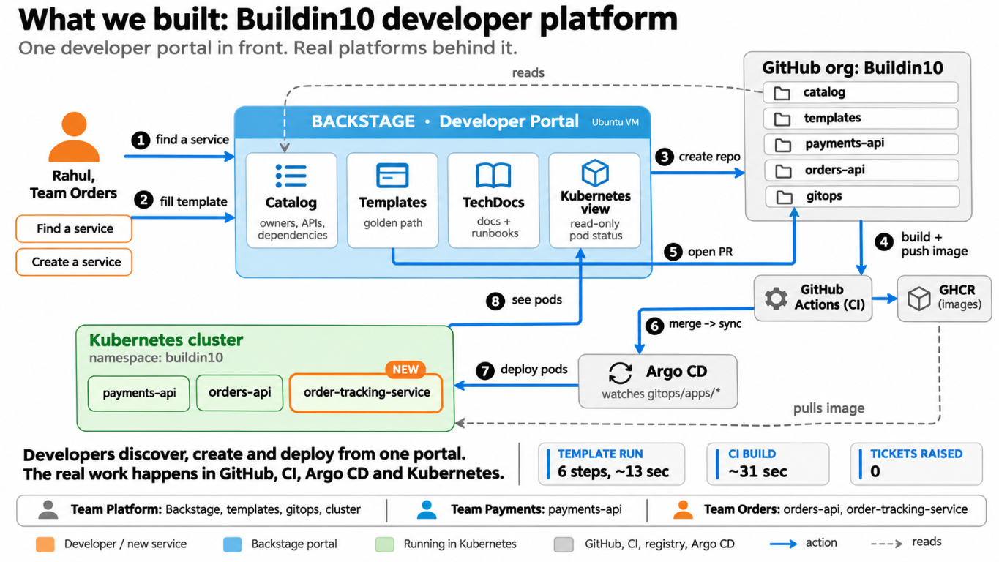

# Buildin10 Internal Developer Platform

This repository shows how to build a complete Internal Developer Platform with Backstage, GitHub, GitHub Actions, GHCR, Argo CD, and Kubernetes.

The demonstration follows the complete developer path:

**Developer → Backstage → GitHub → GitHub Actions → GHCR → GitOps → Argo CD → Kubernetes**

## Architecture



Developers discover existing services and create new ones through Backstage. The template creates a GitHub repository and GitOps pull request. GitHub Actions publishes the container image to GHCR, Argo CD reconciles the merged manifests, and Backstage provides read-only visibility into the resulting Kubernetes workloads.

## Video

> **Video walkthrough: link coming soon.** Add the published YouTube link here before announcing the repository.

## What this demo teaches

- how developers discover services, APIs, ownership, and dependencies in Backstage
- how a Backstage software template creates a service repository
- how GitHub Actions builds and publishes container images to GHCR
- how pull requests introduce Kubernetes desired state through GitOps
- how Argo CD deploys and prunes applications
- how Backstage displays Kubernetes workloads with read-only access
- how to test and clean up the complete workflow safely

## Repository contents

- [`docs/`](docs/) — architecture and step-by-step reproduction guides
- [`scripts/`](scripts/) — host, KIND, Argo CD, RBAC, and validation scripts
- [`infra/`](infra/) — KIND and Backstage Kubernetes access manifests
- [`catalog/`](catalog/) — teams, systems, components, APIs, and OpenAPI example
- [`services/`](services/) — reference Payments and Orders Node.js services
- [`templates/`](templates/) — the six-step Backstage software template
- [`gitops/`](gitops/) — ApplicationSet and sample application manifests
- [`config/`](config/) — safe Backstage and systemd configuration examples

## How to use

1. Read the [architecture](docs/01-architecture.md) and [prerequisites](docs/02-prerequisites.md).
2. Prepare a disposable Ubuntu 24.04 VM with the [host guide](docs/03-host-and-tools.md).
3. Install KIND and Argo CD with the [platform guide](docs/04-kubernetes-and-argocd.md).
4. Publish the five supporting repository examples from the source directories:
   - `catalog`
   - `payments-api`
   - `orders-api`
   - `gitops`
   - `templates`
5. Configure Backstage using the [setup guide](docs/06-backstage-setup.md).
6. Follow the complete [developer journey](docs/07-developer-journey.md).
7. Record evidence with the [end-to-end checklist](docs/08-e2e-test.md).
8. Remove only the temporary service with the [cleanup guide](docs/09-cleanup.md).

## Reference versions

- Ubuntu 24.04.5 LTS
- KIND 0.33.0
- Argo CD 3.6.1
- Node.js 24
- Yarn 4.4.1

The original VM was observed with 32 GiB RAM and 630 GiB disk. These are reference observations, not required provider specifications. Choose capacity based on expected builds, container cache, and concurrent demos.

## Validate locally

```bash
./scripts/validate-local.sh
```

The project is not connected to a live environment. It contains no credentials and does not log in, deploy, or delete remote resources on its own.

## Safety

- Never commit passwords, tokens, private keys, or `.env` files.
- Use a dedicated learning VM; KIND is not a production control plane.
- Replace every `YOUR_*` placeholder before publishing the examples.
- Review every pull request and deployment manifest.
- Cleanup must target `demo-check-service` only.
- Do not create the separate recording service `order-tracking-service` as part of this demo.

## References

- [Backstage](https://backstage.io/docs/)
- [Argo CD ApplicationSets](https://argo-cd.readthedocs.io/en/stable/operator-manual/applicationset/)
- [KIND](https://kind.sigs.k8s.io/)
- [GitHub Container Registry](https://docs.github.com/packages/working-with-a-github-packages-registry/working-with-the-container-registry)

## Connect

- [LinkedIn](https://www.linkedin.com/in/shubham-s-sahoo/)
- [Linktree](https://linktr.ee/1504shubham)
- [Mentoring](https://topmate.io/shubham_suraj_sahoo)
- [Support](https://www.buymeacoffee.com/1504shubhaq)
